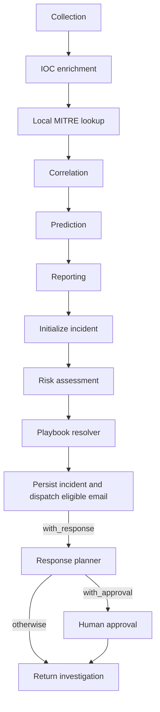
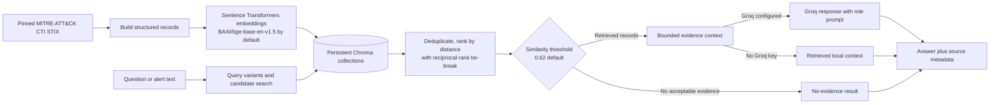

# MedFlow AI Cybersecurity Ecosystem

**MedFlow AI is an AI-assisted cybersecurity investigation and incident-response prototype for digital healthcare.** It combines role-specialized security analysis, retrieval-augmented threat intelligence, and LangGraph orchestration to turn security telemetry into contextual investigations, attack-progression assessments, incident reports, and human-supervised response decisions.

Security teams often receive more alerts than analysts can investigate individually. MedFlow AI is designed to reduce that workload by normalizing telemetry, retrieving relevant cybersecurity knowledge, enriching and correlating evidence, and assembling a reviewable incident assessment. Deterministic controls and source evidence constrain the workflow: model-generated reasoning is treated as analysis, not proof, and sensitive response actions remain subject to human approval.

The project's primary focus is its coordinated AI investigation workflow. The SSH laboratory and simulated ransomware scenario are validation examples for parts of this broader ecosystem, not the system's identity.

This repository is intended for development and authorized isolated-lab use. Detection, AI-assisted investigation, notification, and containment are separate stages. A detection is not proof of compromise; an AI hypothesis is not a confirmed fact; and a recommended response is not an executed response.

## Project status

The following is the latest status reported for the lab. It is not a claim that every capability has been verified end to end.

| Capability | Status | Evidence or limitation |
| --- | --- | --- |
| Wazuh SSH authentication detection | **Verified** | A genuine authentication failure matched Wazuh rule `5760` and was visible in the Dashboard. |
| Suricata SSH connection detection | **Verified** | Lab EVE evidence included SID `9900003`; it detects repeated SSH connections, not necessarily failed passwords. |
| MedFlow access to both alert sources | **Partially verified** | Read-only local ingestion retrieved Wazuh alerts and Suricata signature `1:9900003:1`. The mounted EVE path was confirmed readable in `medflow-app`. |
| FastAPI container startup and health | **Verified** | FastAPI and Uvicorn are declared dependencies; the container health endpoint returned healthy after the dependency repair. |
| Live AI investigation and incident report | **Partially verified** | A six-event Wazuh/Suricata lab preflight and source correlation evidence are saved. The combined investigation was blocked in the recorded validation run. A separate broader run and its dry-run action counts were reported by the operator, but its original output and action-level audit are unavailable for independent verification. |
| SMTP email delivery | **Verified** | A real message was sent successfully through the configured MedFlow email connector. The incident dispatch path also applies severity, freshness, live-source, and allowlist checks. |
| Actual containment | **Pending; not demonstrated** | The CLI is dry-run only. Disruptive response actions require a human decision. Do not report containment as executed based on a proposal or preview. |

## Architecture

```mermaid
flowchart LR
  SSH[Authorized isolated SSH lab]
  SSH -->|auth message| SSHLOG[Target Docker json-file log]
  SSHLOG -->|SSH authentication event| WZ[Wazuh agent and manager]
  SSH -->|network traffic, when visible to sensor| SUR[Suricata lab sensor]
  WIN[Windows Wazuh agent] --> WZ
  SUR -->|EVE JSONL| EVE[Read-only EVE mount]
  WZ --> WI[Wazuh manager / indexer]
  WI --> WC[Wazuh collector]
  EVE --> SC[Suricata collector]
  WC --> N[Normalize and deduplicate]
  SC --> N
  N --> C[Correlate and score]
  C --> IOC[Optional MISP enrichment]
  C --> MITRE[MITRE ATT&CK and local vector search]
  IOC --> R[Investigation report]
  MITRE --> R
  R --> DB[Persist incident and notification outbox]
  DB -->|fresh, severe, allowlisted| MAIL[SMTP notification]
  DB --> PLAN[Response planner]
  PLAN --> APPROVAL[Human approval gate]
  APPROVAL --> EXEC[Executor: CLI dry-run]
```



## Specialized AI agents and investigation roles

The `agents/` package contains four role-specific interfaces over shared RAG retrieval and answer generation. They are specialized prompt-and-tooling roles, not four independent autonomous LangGraph workflows. The LangGraph investigator coordinates deterministic processing nodes and selected model-backed steps using a shared incident state.

| Component | Purpose and knowledge source | Input and output |
| --- | --- | --- |
| CTI agent (`agents/cti_agent.py`) | Explains ATT&CK techniques and threat context, grounded in the local ATT&CK collection. | A question; returns an answer that separates retrieved technique IDs from claims outside retrieved context. |
| Red-team agent (`agents/redteam_agent.py`) | Provides defensive, authorized-lab technique and kill-chain analysis from procedure-oriented ATT&CK records. | A question; returns bounded validation and mitigation guidance with source-grounding instructions. |
| Attribution agent (`agents/attribution_agent.py`) | Compares TTP overlap and actor hypotheses using the actor-profile collection. | A question; returns cautious, evidence-labeled attribution analysis. |
| Detection agent (`agents/detection_agent.py`) | Summarizes detection guidance, analytics, data sources, and mitigations from the detection collection. | A question; returns retrieval-grounded detection context and recommendations, or states that no matching context was found. |
| IOC enrichment (`graphs/nodes/ioc_enrichment.py`) | Graph node that extracts/enriches indicators, maps supported evidence to ATT&CK, and can invoke a LangGraph ReAct agent with configured tools such as reputation, MISP, MITRE, and conditional CVE lookup. | Normalized alerts and shared state; returns enriched IOCs, evidence status, tool provenance, and errors/degraded-service notes. |
| Prediction and reporting nodes | Use retrieved context and selected Groq calls for constrained progression analysis and report narrative; deterministic fallbacks remain available. | Correlated incident state; return prediction metadata and a structured report that should distinguish observed facts from hypotheses. |

The benefit of specialization is separation of analytical tasks and retrieval domains while retaining common incident context. Role prompts request source-aware outputs; deterministic correlation, risk, and policy code still perform important parts of the workflow. LLM availability and quality depend on the configured provider, and semantic retrieval can return no evidence when the query is outside or poorly represented in the local corpus.

### Detection, investigation, and response

- **Detection:** Wazuh analyzes collected endpoint/authentication logs; Suricata analyzes network traffic visible on its monitored interface and writes EVE JSONL. The alerts describe different evidence. SID `9900003` is a connection-pattern detection; rule `5760` is an SSH authentication failure. A genuine SSH authentication failure matched rule `5760` and was visible in the Wazuh Dashboard.
- **Investigation:** collectors normalize events with stable identifiers. The investigator correlates evidence, optionally enriches IOCs, looks up MITRE techniques and produces a report. Local ATT&CK/vector data and Groq-hosted models have separate roles; availability of an external service affects enrichment or AI results.
- **Notification:** live incidents are persisted before notification dispatch. The policy requires live sensor evidence, severity at or above `MEDFLOW_EMAIL_MIN_SEVERITY` (default `8`), evidence no older than `MEDFLOW_EMAIL_MAX_EVIDENCE_AGE_MINUTES` (default `15`), and `SOC_EMAIL` to match an address in `SOC_EMAIL_ALLOWLIST`. Simulation/fixture events are excluded. Real SMTP delivery through the MedFlow connector has been verified.
- **Containment:** response actions are recommendations until a human decision is recorded. Disruptive actions are forced through the approval gate even if a playbook marks them otherwise. The CLI executor is deliberately dry-run; live containment has not been verified. Some remote connectors can change a configured target and require further lab-scope/rollback review before any live execution is enabled.

## Technologies

- **Python 3.11** for the application and collectors.
- **FastAPI and Uvicorn** for the `/health` endpoint and legacy Wazuh webhook entry point.
- **Docker Compose** for the MedFlow application and optional supporting services.
- **Wazuh 4.12** for endpoint telemetry, rule matching, alert indexing, and Dashboard.
- **Suricata** for network detection and EVE JSON output.
- **MISP / PyMISP** for optional IOC enrichment; MISP is not a service in the root Compose file.
- **MITRE ATT&CK STIX** for technique context, with local ChromaDB indexes for retrieval.
- **Sentence Transformers** with the configured `BAAI/bge-base-en-v1.5` embedding model for semantic retrieval.
- **Groq API** for configured investigation/planning models. A valid key and network access are required for those calls.

## Investigation workflow

The live workflow is implemented by `medflow_investigator.pipeline.run_investigation` as a LangGraph state machine. Its state combines normalized alert/evidence fields with incident fields; the graph is not a general-purpose autonomous agent. Most nodes use deterministic code, with model calls limited to specific enrichment, narrative, prediction, or planning steps.



| Node | Responsibility and state effect |
| --- | --- |
| `collection_node` | Reads Wazuh and Suricata in live mode, normalizes fields, checks schema, deduplicates stable event IDs, and records source metadata. If no live events are returned, current code can fall back to a simulated fixture; inspect source/counts before treating output as live. |
| `ioc_enrichment_node` | Uses explicit technique hints and structural Wazuh evidence first, then semantic ATT&CK retrieval where appropriate. A LangGraph ReAct agent can call configured reputation, MISP, MITRE, and conditional CVE tools. Service preflight/tool failures are reported and enrichment degrades rather than disabling TLS verification. |
| `mitre_lookup_node` | Adds local deterministic MITRE technique metadata and kill-chain mapping. Despite its name, it does not itself perform vector retrieval. |
| `correlation_node` | Filters operational noise and groups related evidence using host/time scope (72-hour default); derives campaign/stage/confidence and evidence status. Sparse evidence is kept explicitly insufficient rather than promoted to a confirmed finding. |
| `prediction_node` | Skips prediction when evidence/confidence is insufficient. Otherwise queries red-team and detection RAG, constrains predicted techniques to retrieved candidates and later kill-chain tactics, and labels its timing estimate `Unknown`. Scores are heuristics, not calibrated probabilities. |
| `reporting_node` | Builds deterministic report sections and may add Groq narrative. Missing keys, weak live evidence, and model errors use a deterministic fallback. |
| `initialize_incident_node` | Maps investigation state to the incident schema. Live IDs derive from sorted source event IDs; simulated IDs are generated separately. |
| `risk_assessment_node` | Calculates a deterministic weighted risk from severity, asset criticality, and confidence; low confidence requires review. This is a project score, not a validated clinical or operational risk model. |
| `playbook_resolver_node` | Selects a YAML playbook from confirmed techniques/kill-chain position, falls back deterministically, and sets the allowed action vocabulary. |
| `persist_live_incident_node` | For live incidents, persists first, records eligible notification work in the SQLite outbox, acknowledges source event IDs only after commit, then attempts dispatch. Persistence is retained if notification fails. |
| `response_planner_node` | Produces proposed actions with Groq when configured or deterministic fallback proposals; validates action names against policy and marks mandatory-human actions. |
| `approval_node` | Records explicit named decisions for gated actions; noninteractive missing decisions are rejected. Approval is a recorded decision, not evidence that an action executed. |

`with_response` adds planning after persistence. `with_approval` adds the approval node and ends at that gate; the separate `medflow_executor` graph consumes a serialized handoff and runs the executor/closure workflow. The documented CLI uses dry-run execution. Live containment is not verified and must not be inferred from an approved plan or execution preview.

The graph is an orchestrated investigation workflow, not a claim that every stage is an independent AI agent:

```mermaid
flowchart LR
  A[Wazuh and Suricata events] --> B[Collection and normalization]
  B --> C[IOC enrichment and optional tool-using analysis]
  C --> D[Local ATT&CK lookup]
  D --> E[Correlation and evidence assessment]
  E --> F[Prediction with RAG context]
  F --> G[Incident report]
  G --> H[Incident initialization and risk score]
  H --> I[Playbook resolution]
  I --> J[Persist incident and eligible notification outbox]
  J --> K[Response plan]
  K --> L[Human approval gate]
  L --> M[Separate executor workflow: dry-run in documented CLI]
```



## RAG and AI components

RAG is a local retrieval pipeline over structured MITRE ATT&CK STIX-derived material, with optional Groq generation. It is not a general web search system and does not turn similarity into proof.



The source is the Enterprise MITRE ATT&CK STIX repository. The build script pins a repository revision and checks the configured source digest unless an explicit override is supplied. Building indexes may download the embedding model only when explicitly permitted; an existing model cache can be reused. Records are structured at technique/entity level rather than generated by a generic text chunker:

| Collection | Indexed material and use |
| --- | --- |
| `attack_db` | Technique name, tactics, description, and detection guidance; used for technique context. |
| `redteam_db` | Procedure examples linking techniques to groups, malware, and tools; used for adversary procedure/prediction context. |
| `actor_db` | Intrusion sets, malware, tools, aliases, and descriptions; used for attribution context. |
| `detection_db` | Detection strategies, analytics, data sources/components, and mitigations; used for detection engineering context. |

The shared query pipeline creates query variants, searches the relevant Chroma collection, deduplicates by document ID, ranks by Chroma distance with reciprocal-rank as a tie-breaker, and applies a default project similarity threshold of `0.62`. That converted similarity is not a probability. Retrieved context is bounded before a configured Groq model is called; without a Groq key, the pipeline can return local retrieved context. The `agents/` package provides role-specific CTI, attribution, detection, and red-team wrappers around this shared retrieval/generation path; these are not four independent autonomous graph workflows.

Evaluation assets document a 39-query labeled development/held-out set. The recorded evaluation reports Recall@3 of 78.85% raw and 76.92% after thresholding, Precision@3 of 30.71% raw and 29.96% after thresholding, MRR of 75.84%, and rejection of 10/10 out-of-domain probes. These are dataset-specific retrieval metrics; the target recall was not met, and they do not measure operational incident accuracy.

## Threat intelligence and evidence boundaries

- **Wazuh** supplies collected endpoint and authentication alerts from its API/indexer. The collector uses configured credentials and strict TLS verification, with an explicitly trusted CA bundle supported for private deployments. Collection of `medflow-ssh-target` logs is not currently configured; its Docker log output is not itself an indexed Wazuh alert.
- **Suricata** supplies network events from EVE JSONL. Its alerts describe observed traffic or rule matches; they do not establish endpoint authentication outcomes. Current lab SID `9900003` detects an SSH connection pattern, while Wazuh rule `5760` represents an SSH authentication failure.
- **MISP** is an optional external IOC source. The root Compose file does not deploy it. The graph's preflight disables MISP querying for a run when service readiness/trust checks fail.
- **MITRE ATT&CK** is available locally through STIX-derived metadata and Chroma indexes. Local technique lookup and RAG are separate mechanisms in this implementation.
- **AbuseIPDB and NVD** are optional tools for public-IP reputation and CVE context. Private/reserved addresses are skipped for reputation lookup; external tools require their respective endpoint/key and network access.
- **Groq** is an optional hosted LLM provider for selected investigation, report, and response-planning steps. Deterministic fallbacks exist, but output quality and availability depend on configuration and evidence.

Treat sensor records as confirmed observations, correlation/attribution as analysis, and model-generated claims as hypotheses until supported by source evidence. Reports retain this distinction; they must not state that containment occurred unless execution and audit evidence confirm it.

## Validation scenarios and evidence

Validation is organized around capabilities rather than one detection demo. Results below distinguish checked retrieval/source behavior from the complete live incident workflow:

| Phase | Capability | Current evidence and status |
| --- | --- | --- |
| 1. Retrieval and specialized roles | ATT&CK-derived collections, semantic search, role-specific Q&A, grounding and retrieval evaluation. | The repository includes a labeled evaluation dataset and published development/held-out results described above. These retrieval metrics do not establish incident-investigation accuracy. |
| 2. Simulated campaign investigation | Ryuk fixture, ATT&CK context, stage reasoning, risk/reporting, and ransomware playbook resolution. | Scenario code, playbook, and offline tests are present. Treat fixture results as simulated; they are not live ransomware observations. |
| 3. Multi-source lab telemetry | Isolated SSH activity observed by Wazuh and Suricata, normalized and matched across sources. | Saved preflight evidence contains five Wazuh rule `5760` events and one Suricata SID `9900003` event. One pair shares source IP, source port, event second, and target context. This validates source acquisition/correlation evidence, not the entire investigation workflow. |
| 4. End-to-end SSH investigation and response planning | Enrichment, ATT&CK mapping, campaign assessment, report, playbook, approval, and dry-run action handling. | The saved validation matrix records the combined investigation as **blocked** and notifications/executor as **not run**. A separate run summary was reported with six relevant alerts, ATT&CK `T1110`/`T1110.001`, Credential Access, risk `73/100`, six planned actions, three successful dry-run simulations, two rejected actions skipped, and one unsupported `MONITOR_ACCOUNT` handler. Its original console output and action-level audit are not available in the evidence folder, so these figures remain **operator-reported, not independently verified here**. Do not present this phase as a verified successful end-to-end run until its artifacts are captured and reviewed. |

The cross-source records establish an attempted SSH authentication event, not a successful login or compromise. The Wazuh predecoder timestamp omits a timezone; timestamp matching should be interpreted alongside the matching source IP, source port, destination, and target context. The Suricata SID describes network connection behavior and does not itself prove password failure.

## Repository map

```text
agents/                    Agent roles for attribution, CTI, detection, and red-team analysis
collectors/                Wazuh and Suricata ingestion, normalization, checkpoints
data/simulated_alerts/     Intentionally maintained offline scenarios and fixtures
docker/                    MedFlow container startup and Docker notes
graphs/nodes/              Investigation, reporting, risk, approval, and response nodes
integrations/              Email, firewall, IDS, EDR, and remote execution adapters
medflow_contracts/         Serialized Investigator-to-Executor contracts
medflow_investigator/      Collection through persistence and optional approval workflow
medflow_executor/          Executor workflow and response-action handling
models/                    Alert/incident models and SQLite persistence/outbox
playbooks/                 YAML response playbooks and action vocabulary
rag/                       Structured ATT&CK RAG pipeline, retrieval, and evaluation assets
scripts/                   Setup, build, audit, and explicitly gated verification tools
suricata/                  Suricata image, rules, and sensor configuration
tests/                     Offline unit tests and opt-in external/integration tests
wazuh/                     Manager configuration and integration/active-response scripts
api.py                     FastAPI health and webhook endpoints
app.py                     CLI for status, agent Q&A, investigation, and handoff
config.py                  Environment settings and local data paths
docker-compose.yml         Root Compose application/supporting-service definitions
requirements.txt           Python runtime dependencies
```

The SSH lab definitions and some deployed Wazuh/Suricata infrastructure are maintained outside this public repository. Do not add lab passwords, private keys, local Wazuh clones, or raw production telemetry here.

## Prerequisites and installation

- Windows 11 with PowerShell and Docker Desktop, or a supported Linux Docker host.
- Python 3.11 for host-side CLI/tests; Docker uses the Python 3.11 slim image.
- Git and network access for initial MITRE data, package, model, and optional API downloads.
- Credentials and trusted CA material configured locally where needed.

Create a host Python environment:

```powershell
py -3.11 -m venv .venv
.\.venv\Scripts\Activate.ps1
python -m pip install --upgrade pip
python -m pip install -r requirements.txt
Copy-Item .env.example .env
```

Edit `.env` locally. Fill credentials with deployment-specific values; do not commit the file. Set a Groq key only if using hosted model calls. MISP and SMTP settings are optional for a minimal investigation run, but their integrations will not work without valid configuration.

For email, configure `SMTP_HOST`, `SMTP_PORT`, `SMTP_USER`, `SMTP_PASSWORD`, `SMTP_FROM`, `SOC_EMAIL`, and `SOC_EMAIL_ALLOWLIST`. Keep the allowlist empty until a real SOC recipient is intentionally configured; a sample `.env.example` must not send messages. Use `EMAIL_MODE=gmail` for SMTP delivery and the mock mode only for tests/local development.

The application verifies Wazuh TLS certificates by default. Keep `WAZUH_VERIFY_TLS=true`; if Wazuh uses a private CA, set `WAZUH_CA_BUNDLE` to the trusted CA file **inside the container** and mount that certificate read-only. Never use `verify=False` or an untrusted certificate path.

## Docker Compose and health checks

Validate the Compose file without starting or changing services:

```powershell
docker compose config --quiet
```

On a Linux host, the root Compose file describes MedFlow, Wazuh services, and a Suricata service configured for host networking. On Docker Desktop for Windows, host networking does not provide the same packet-capture behavior; use the already configured isolated lab sensor and its deployment-specific instructions. The root Compose file does not define the disposable SSH lab or a MISP service.

If the approved Wazuh/lab services are already running and reachable on the configured network, build/start only the MedFlow app service with:

```powershell
docker compose up -d --build --no-deps medflow
```

The `--no-deps` option avoids touching other services. The first app start can download MITRE data and build vector indexes if their persistent volumes are empty; those operations can consume significant time and disk space. Existing named volumes hold the model cache, vector DBs, MITRE CTI data, and application logs. The SQLite incident database and collector checkpoints default under `/app/data`; the root Compose file does not currently give that directory its own persistent volume. Treat container recreation as a checkpoint/outbox persistence risk until that storage is explicitly migrated and verified.

Check service state and the local API health endpoint:

```powershell
docker compose ps medflow
Invoke-RestMethod -Uri http://localhost:8000/health
```

Expected health response: `status = healthy`. The root Compose ports include the MedFlow API on `8000`, Wazuh API on `56000`, indexer on `9200`, and Dashboard on `8443`; use the locally configured CA/trust store when accessing TLS endpoints. Do not add `curl -k` or disable certificate verification to work around trust errors.

## Authorized SSH lab workflow

Run only against the isolated, authorized lab. The user-maintained lab uses a disposable SSH target on port `2222`; the lab credentials are intentionally omitted. The lab Compose definitions are not included here, so use the deployment file and credentials maintained in that lab environment rather than copying values into this repository.

1. Start the existing isolated SSH lab and verify that the target is reachable from the test source.
2. Confirm Wazuh is active and that SSH authentication failures are decoded and indexed, using rule `5760` in the Dashboard as the reference. The active `wejden-cherif` agent is the Windows endpoint.
   - Verify that the Suricata sensor can observe traffic on the lab path. The root `suricata/docker-compose.yml` uses host networking for a Linux deployment and is not a substitute for the Windows Docker Desktop lab sensor.
3. Generate only bounded, authorized authentication activity using the lab's approved procedure. No attack command is provided here because the lab-specific source/target authorization and rate controls are external to this repository.
4. Confirm Suricata wrote a fresh EVE event for SID `9900003`. This establishes a network connection pattern, not failed-password evidence.
5. Confirm Wazuh produced/indexed an SSH authentication failure, such as rule `5760`, in the Dashboard. A `wazuh-logtest` result tests decoder/rule matching only; it does not create an indexed alert.
6. Confirm the app container reads the intended lab EVE file. Compose sets `SURICATA_EVE_PATH=/app/suricata/lab-logs/eve.json` and mounts `./suricata/lab-logs` read-only at that path. Host-side Python needs its own host-readable path.
7. Run the live investigation only after confirming both collectors point at the intended authorized lab sources. `python app.py investigate --scenario live --with-response` requests live collection, report generation, response planning, and an interactive approval step. The CLI executor remains dry-run. Inspect its `Data source`, `Live alerts`, and `Simulated alerts` counts; `live` falls back to a simulated fixture if no live alerts are collected.
8. A qualifying persisted live incident is eligible for automatic email when the freshness/severity policy, allowlist, and SMTP settings all pass. Real SMTP delivery through the connector has been verified; automatic email from a live incoming incident has not been verified end to end.
9. Containment must not be described as completed unless the target system and audit record confirm the approved action. Live containment is not available through the documented CLI and has not been demonstrated.

The explicit read-only verification utility is `scripts/verify_lab_ingestion.py`. From PowerShell, after verifying the configured Indexer account is read-only and TLS trust is correct:

```powershell
$env:MEDFLOW_ENABLE_READ_ONLY_LAB_INGESTION = "1"
python scripts/verify_lab_ingestion.py `
  --live-lab-read-only `
  --confirm-authorized-read-only `
  --confirm-trusted-tls `
  --max-events 25 `
  --lookback-days 1
Remove-Item Env:MEDFLOW_ENABLE_READ_ONLY_LAB_INGESTION
```

It uses temporary checkpoints and does not persist incidents, send email, execute response actions, modify EVE data, or generate traffic. Review `python scripts/verify_lab_ingestion.py --help` before use.

## CLI and API

Useful CLI entry points:

```powershell
python app.py --help
python app.py status
python app.py investigate --help
python app.py investigate --scenario live --investigate-only
```

`--scenario live` can fall back to the default simulated scenario if collection fails or returns no live events. Check the printed source and alert counts before treating a report as live evidence. `--with-response` adds planning and an approval gate, but the CLI passes a dry-run handoff to the executor. The standalone `execute` CLI rejects live handoffs.

The FastAPI service exposes `GET /health` and a legacy `POST /webhook/wazuh` endpoint. The webhook has no authentication/signature verification in this repository; keep it on a trusted local/lab network and do not expose it to the Internet or an untrusted network. Background requests cannot collect interactive human approval, so response actions remain non-executing/dry-run.

## Verification and testing

The default pytest configuration selects tests marked `unit` and excludes tests marked `integration`, `slow`, or `requires_external`:

```powershell
python -m pytest -q
python -m pytest tests/test_alert_ingestion.py -q
python -m pytest tests/test_response_planner.py tests/test_response_executor.py -q
```

External-service tests require explicit review and opt-in; do not run them during a normal offline test pass. Tests that use fake SMTP/remote runners are not proof of a real email or containment event.

Other safe checks:

```powershell
python -m compileall -q app.py api.py config.py collectors graphs integrations medflow_contracts medflow_executor medflow_investigator models
python app.py --help
python app.py investigate --help
git diff --check
```

Inspect Suricata evidence without modifying it:

```powershell
Get-Content .\suricata\lab-logs\eve.json -Tail 20
```

For Wazuh, use the Dashboard’s alert search and confirm the rule ID, source agent, and timestamp. Avoid copying raw logs or IPs into public issue reports. The read-only ingestion script is safer for collector validation than a full investigation; consult its `--help` and required safety switches first.

## Troubleshooting

### `ModuleNotFoundError: No module named 'fastapi'`

FastAPI and Uvicorn are declared in both `requirements.txt` and `pyproject.toml`; rebuild only the MedFlow image after dependency changes. The Dockerfile installs `requirements.txt` before copying application source.

### Suricata path does not resolve in the app container

Compose explicitly supplies `/app/suricata/lab-logs/eve.json` and a read-only bind mount. A host-only relative path such as `suricata/logs/eve.json` is not necessarily valid inside the container. Confirm the file-sharing path and mount with Docker Desktop, and confirm the container user can read the file. Do not change the source EVE timestamps or disable read-only mounting to hide a permission issue.

### Windows bind-mount permissions or Wazuh read-only paths

Windows-to-Linux bind mounts can have different ownership and mode semantics. Ensure Docker Desktop shares the repository drive and the container can read the mounted file. Keep Wazuh telemetry mounts read-only where configured. A Wazuh rootcheck permission warning may describe Docker Desktop’s Linux-side view, not a reason to loosen host permissions globally.

### MISP preflight fails

MISP is optional and not started by the root Compose file. A refused connection means the configured endpoint is unavailable; HTTP `503` means the service is reachable but not ready. Check `MISP_URL`, TLS trust, and the separate MISP deployment. Enrichment should remain disabled for that run rather than bypassing TLS.

### Suricata and Wazuh evidence disagree

Suricata observes network behavior, such as repeated SSH connections. Wazuh observes endpoint authentication records and can identify failed logins. A Suricata connection alert alone does not prove failed credentials, and a Wazuh decoder test alone does not prove an indexed incident.

### Confirming SSH authentication alerts in Wazuh

Search the Wazuh Dashboard for rule `5760` and review the event timestamp, source address, and agent fields to confirm the SSH authentication alert. The verified lab event matched this rule and was visible in the Dashboard. A `wazuh-logtest` result checks decoder/rule matching; the Dashboard confirms that an alert was indexed.

### No incident email arrives

If an eligible incident does not produce a notification, check that the event is live and within the configured freshness window, its normalized severity reaches the threshold, `SOC_EMAIL` is in `SOC_EMAIL_ALLOWLIST`, SMTP mode and settings are valid, and the incident has an outbox record. Real SMTP delivery through the connector has been verified; keep credentials out of logs and terminal transcripts.

## Security and responsible use

- Use only authorized, isolated lab systems and bounded activity.
- Keep `.env`, local environment backups, Wazuh/MISP clones, CA private keys, model caches, EVE files, local databases, checkpoints, and incident evidence out of Git.
- Use trusted CA bundles and strict TLS verification for Wazuh/MISP endpoints.
- Run collectors with least-privilege read-only access where possible.
- Review every proposed response action. Containment must be explicitly approved, narrowly scoped to the isolated lab, auditable, and reversible before live execution is enabled.
- Do not expose the unauthenticated webhook outside a trusted local network.
- Do not claim incident persistence or containment from mock tests, a proposal, or a dry-run report. SMTP delivery through the connector has been verified.

Some deployment files, credentials, and lab services are intentionally external to this repository. Review the deployment-specific configuration before using the project outside the isolated lab.
