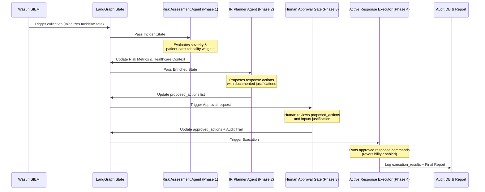

# Incident Response Schema Design (Phase 0)

This document provides the design rationale, field mappings, framework alignments, and future consumption patterns for the **Incident Response Data Model** implemented in Phase 0.

---

## 1. Architectural Overview & Design Principles

The MedFlow AI Cybersecurity Ecosystem prioritizes **healthcare safety, visibility, and compliance**. In accordance with these priorities, the incident response data model is split into two distinct structures:

1. **`IncidentState` (LangGraph State)**:
   - *Nature*: Mutable, transient, and potentially incomplete.
   - *Role*: Carries data between LangGraph nodes during the investigation and planning lifecycle. Fields are populated incrementally as threat intelligence, correlation, prediction, and planner nodes execute.
   
2. **`Incident` (Canonical Record)**:
   - *Nature*: Strongly typed, validated, and immutable where required (e.g., the append-only audit log).
   - *Role*: Serving as the permanent database record (e.g., in SIEM or DB storage) and reporting artifact.

### State-to-Record Transition: `Incident.from_state()`
To prevent nodes from directly modifying unvalidated values in `IncidentState` (such as bypassing the healthcare criticality override rule), the factory method `Incident.from_state(state: IncidentState) -> Incident` is the designated interface to validate in-flight data. 

Calling this method constructs a canonical `Incident` directly via its primary constructor. This ensures that:
- **Zero Duplication of Logic**: The severity tier derivation and healthcare criticality weight overrides are performed solely in the class constructor.
- **Immediate Invariant Enforcement**: If any direct patient-care systems (like infusion pumps) were manually set to `Low` or `Medium` asset criticality in `IncidentState`, they are immediately upgraded to `High` in the returned `Incident` object, and standard validation errors are raised if any required data is missing.

---

## 2. Field-by-Field Design Rationale

### A. Identification & Metadata
* **`incident_id`** (str)
  - *Why it exists*: Serves as the primary key for tracking and forensic reference.
  - *Inspiration*: **NIST SP 800-61 Rev. 2** (Incident Handling Guide) requirement for a centralized tracking system.
  - *Future Agent Consumption*: The **Reporting Agent** and **Human Approver Interface** use this to query, track, and log the incident lifecycle.
* **`timestamp`** (str, ISO 8601)
  - *Why it exists*: Establishes the canonical creation time of the incident record.
  - *Inspiration*: **NIST SP 800-61** documentation timeline standards.
* **`title`** (str) / **`category`** (str) / **`status`** (str)
  - *Why it exists*: Provides human-readable context and defines where the incident stands in its lifecycle (e.g., `identified`, `investigating`, `plan_proposed`, `resolved`).
  - *Inspiration*: Mapped to standard incident triage categories and NIST incident states.
* **`schema_version`** (str)
  - *Why it exists*: Enables backward-compatibility and smooth data migrations as the MedFlow platform scales through Phases 1-4.
* **`source`** (str)
  - *Why it exists*: Explicitly denotes whether the incident is derived from actual production telemetry (`wazuh_live`) or a scenario simulation (`simulated`).

### B. Detection Context
* **`wazuh_alerts`** (list[dict])
  - *Why it exists*: Contains normalized telemetry gathered directly from the Wazuh SIEM.
  - *Correlation Strategy*: One-to-many relationship. A security campaign identified in the Correlation node creates a parent `Incident` that references multiple child Wazuh alerts (linked via `id` and `wazuh_rule_id`).
* **`rule_id`** (str)
  - *Why it exists*: Identifies the primary triggering rule or ruleset from the SIEM.
* **`logs`** (list[str]) / **`evidence`** (list[dict])
  - *Why it exists*: Holds the exact raw log data and evidentiary artifacts.
  - *Inspiration*: **NIST SP 800-61** Guidelines on Evidence Preservation (crucial for legal accountability).
  - *Future Agent Consumption*: Used by the **IR Planner Agent** to verify hostnames and extract network indicators (IPs, processes) for mitigation actions.

### C. Threat Intelligence
* **`iocs`** (list[dict]) / **`threat_actor`** (str)
  - *Why it exists*: Enriched IOCs (IPs, hashes) and actor attribution profiles from tools like MISP and external threat feeds.
  - *Inspiration*: **MITRE ATT&CK** and CTI standards.
* **`mitre_tactics`** (list[str]) / **`mitre_techniques`** (list[str])
  - *Why it exists*: Maps the adversary's actions to specific tactics and techniques.
  - *Inspiration*: **MITRE ATT&CK Framework**.
  - *Future Agent Consumption*: The **IR Planner Agent** consumes these techniques to match them with specific defensive courses of action (e.g., isolating a port if RDP/T1021.001 is detected).

### D. Risk Indicators
* **`severity`** (int) / **`severity_tier`** (str)
  - *Why it exists*: Mapped to the 0-15 scale defined by Wazuh rule levels. The tier is automatically derived: Low (0-4), Medium (5-9), High (10-12), and Critical (13-15).
  - *Future Agent Consumption*: Used by the **Risk Assessment Node** to determine escalation paths and by the **Human Approval Gate** to enforce strict sign-offs (e.g., Critical events require immediate multi-party notification).
* **`confidence_score`** (float, 0.0-1.0)
  - *Why it exists*: Aggregated certainty score computed by the pipeline itself (combining IOC reputation, correlation strength, and prediction certainty).
  - *Future Agent Consumption*: Enforces safety thresholds (e.g., if confidence is <0.5, automated IR plans are halted or marked as low priority).
* **`asset_criticality`** (str) / **`affected_assets`** (list[str])
  - *Why it exists*: Identifies which hosts or network segments are impacted.
  - *Healthcare Weighting Rule*: **Direct patient-care systems (e.g., infusion pumps, patient monitors, EHR databases) automatically default to at least High/Critical criticality.**
  - *Inspiration*: **HIPAA Security Rule** (§ 164.308) and patient safety guidelines.
  - *Future Agent Consumption*: **Risk Assessment Agent** and **IR Planner** use this to prioritize response sequencing (e.g., isolating clinical networks versus corporate workstations).

### E. Response Preparation & Timeline
* **`proposed_actions`** / **`approved_actions`** / **`execution_results`** (list[ResponseAction])
  - *Why it exists*: Structural fields detailing actions (e.g., network blocking, user disabling) that are proposed by the AI, approved by humans, and executed.
  - *Inspiration*: **NIST SP 800-61** Containment, Eradication, and Recovery phase.
  - *Future Agent Consumption*: Consumed by the **Active Response Executor** (Phase 4) and the **Human Approval Gate** (Phase 3).
* **`detection_time`** / **`investigation_time`** / **`response_time`** / **`closure_time`** (str, ISO 8601)
  - *Why it exists*: Tracks key metric intervals (Mean Time to Detect / Respond / Resolve).

### F. Healthcare Context & Compliance Audit
* **`affected_asset_type`** (str) / **`potential_patient_impact`** (str)
  - *Why it exists*: Captures clinical risk specifically (e.g., clinical downtime, patient safety risk).
  - *Inspiration*: **FDA Medical Device Cybersecurity** and **HHS HPH sector** guidance.
* **`audit_log`** (list[AuditLogEntry])
  - *Why it exists*: An immutable, append-only ledger tracking every mutation, decision, justification, and approval.
  - *Inspiration*: **HIPAA Security Rule Audit Controls (§ 164.312(b))**.
  - *Future Agent Consumption*: Critical for forensic post-incident reviews and compliance reporting.

---

## 3. Future Agent Integration Flow

